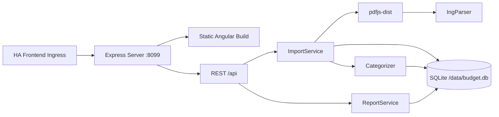

# Mitwirken

Danke für dein Interesse! Dieses Dokument beschreibt die lokale Entwicklung der Add-ons.
Jedes Add-on liegt in einem eigenen Verzeichnis (z. B. [`budget_tracker/`](budget_tracker)) und
ist ein eigenständiges npm-Projekt; alle Befehle werden im jeweiligen Add-on-Verzeichnis
ausgeführt.

## Repository-Struktur

Das Repository folgt dem Aufbau eines Home Assistant Add-on Repositorys. Der Supervisor erkennt
jedes Verzeichnis mit einer `config.yaml` als eigenes Add-on:

```
repository.yaml              # Metadaten des Add-on Repositorys
README.md                    # Übersicht des Repositorys
.github/workflows/           # CI, Code Quality und Releases (für alle Add-ons)
.github/scripts/             # Hilfsskripte der Workflows
new_addon/                   # Add-on „Neues Add-on“ (Grundgerüst, gleicher Aufbau)
ing_depot/                   # Add-on „ING Depot“ (gleicher Aufbau)
budget_tracker/              # Add-on „Haushaltsbuch“
  config.yaml                # Add-on-Konfiguration (Version, Architekturen, Ingress)
  Dockerfile                 # Multi-Stage Build (node:24-alpine)
  README.md                  # Kurzbeschreibung (Info-Tab im Add-on Store)
  DOCS.md                    # Benutzer-Dokumentation (Tab „Dokumentation“)
  CHANGELOG.md               # Änderungen pro Version (Tab „Changelog“, Release Notes)
  shared/api-types.ts        # Gemeinsame DTOs
  server/                    # Express-Backend (TypeScript)
    src/main.ts              # Entry Point, Port 8099
    src/db/                  # SQLite-Schema, Seed-Daten
    src/parsing/             # PDF-Textextraktion, ING-Parser
    src/categorization/      # Regelbasierte Kategorisierung
    src/services/            # Import, Reports
    src/routes/              # REST-API-Endpunkte
    test/                    # Server-Tests
  src/                       # Angular-Frontend
    app/core/                # ApiService, Format-Helfer, Theme
    app/features/            # Feature-Komponenten (Upload, Übersicht, …)
    app/shared/              # Chart-Wrapper
```

## Lokale Entwicklung

Voraussetzungen: Node.js ≥ 24, npm.

```bash
cd budget_tracker   # bzw. das Verzeichnis des gewünschten Add-ons
npm install
```

### Frontend + Backend gleichzeitig

```bash
# Terminal 1: Angular Dev-Server (mit API-Proxy zum Backend)
npm start

# Terminal 2: Express-Backend
npm run dev:server
```

Öffne `http://localhost:4200/`. Der Proxy leitet `/api/*` an `http://localhost:8099` weiter.

### Build

```bash
npm run build:all     # Frontend + Backend
npm run build         # Nur Frontend
npm run build:server  # Nur Backend
```

### Tests & Code-Qualität

```bash
npm run test:server   # Server-Tests (Vitest)
npm test              # Angular-Tests
npm run lint          # ESLint
npm run format:check  # Prettier
npm run typecheck     # TypeScript
npm run check         # Alle Prüfungen auf einmal
```

Die Workflows [CI – Build & Tests](.github/workflows/ci.yml) und
[Code Quality](.github/workflows/code-quality.yml) führen diese Prüfungen bei jedem Push und
Pull Request auf `main` aus – je Add-on als eigener Job und nur für Add-ons, deren Verzeichnis
sich geändert hat. Änderungen unter `.github/` und manuelle Läufe prüfen alle Add-ons.
Voraussetzung: Jedes Add-on stellt dieselben npm-Skripte bereit (`build:all`, `test:coverage`,
`test:server:coverage`, `format:check`, `typecheck`).

### Docker-Image bauen

```bash
docker build -t budget-tracker budget_tracker
```

## Architektur (Haushaltsbuch)



- **Frontend**: Angular 22 mit Signal-basierten Komponenten, Chart.js für Diagramme
- **Backend**: Node.js/Express (TypeScript), SQLite über `node:sqlite`
- **PDF-Parser**: pdfjs-dist mit ING-spezifischem Layout-Parser
- **Container**: Ein Docker-Container liefert das Angular-Frontend statisch aus und stellt die
  REST-API bereit

## Release

Jedes Add-on wird einzeln versioniert. Tags haben die Form `<add-on-verzeichnis>-v<version>`,
z. B. `budget_tracker-v1.2.0`.

1. Version in `<addon>/config.yaml` **und** `<addon>/package.json` erhöhen.
2. Abschnitt `## <Version> (<Datum>)` in `<addon>/CHANGELOG.md` ergänzen.
3. Tag pushen:

   ```bash
   git tag budget_tracker-v1.2.0
   git push origin budget_tracker-v1.2.0
   ```

Der Workflow [Automated Release](.github/workflows/release.yml) prüft, dass Tag, `config.yaml`
und `package.json` dieselbe Version tragen, führt CI und Code Quality für dieses Add-on aus und
erstellt anschließend das GitHub-Release mit den Release Notes aus dem Changelog. Versionen mit
Suffix (z. B. `1.2.0-beta.1`) werden als Pre-Release veröffentlicht.

Ältere Releases des Haushaltsbuchs (bis 1.1.0) tragen noch Tags ohne Präfix (`v1.1.0`).

## Neues Add-on anlegen

Das Verzeichnis [`new_addon/`](new_addon) ist ein lauffähiges Grundgerüst (Angular + Express,
HA-Theme, Ingress-IP-Filter, Tests). Um daraus ein eigenes Add-on zu machen bzw. ein weiteres
anzulegen:

1. Verzeichnis kopieren oder umbenennen; der Verzeichnisname ist der `slug` (nur `a-z`, `0-9`,
   `_`).
2. In `config.yaml` `name`, `slug`, `description`, `panel_icon` und `panel_title` anpassen;
   `stage: experimental` entfernen, sobald das Add-on nutzbar ist.
3. Namen in `package.json` (`name`), `Dockerfile` (Labels), `src/index.html` (`<title>`),
   `src/app/app.html` (`nav-brand`), `server/src/main.ts` (Start-Log), `README.md`, `DOCS.md`
   und den Badge-URLs ersetzen. Wer das Angular-Projekt `NewAddon` umbenennt, passt auch
   `angular.json` und `staticDir` in `server/src/config.ts` an.
4. Das Verzeichnis in [`.github/dependabot.yml`](.github/dependabot.yml) unter `directories`
   (npm und docker) eintragen und das Add-on in der [README](README.md) aufführen.

CI, Code Quality und Releases erkennen das Add-on automatisch an seiner `config.yaml`.

## Lizenzen der Abhängigkeiten (Haushaltsbuch)

- Angular: MIT
- Express: MIT
- pdfjs-dist: Apache-2.0
- chart.js: MIT
